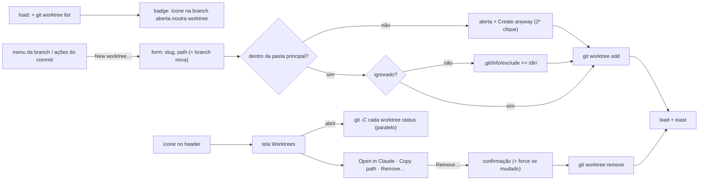

# Worktrees — Design da fase WT (worktree básica)

Escopo: **WT-01..WT-04** do `spec.md`. As fases WE (contrato `gitgraph.json`) e WS (skill) têm design próprio depois; aqui só ficam os ganchos para elas.

Constraints do `context.md`: caminho C (o gitgraph só conhece git; o ambiente é do projeto), worktrees em `.claude/worktrees/<slug>` por padrão, o mod não troca o diretório da sessão.

## 1. Onde a WT aparece no painel

Três abordagens consideradas:

| | Onde | A favor | Contra |
|---|---|---|---|
| **A. Tela própria** *(escolhida)* | Ícone no toolbar do header abre a tela **Worktrees** (como Settings, Changelog, Compare), uma linha por worktree com as ações dela | Espaço para crescer na fase WE (status, links, logs, check por worktree) sem refazer; segue o padrão das telas | Um clique a mais que um dialog |
| B. Dialog do header | Lista num dialog flutuante, como o Git Flow | Rápido de abrir | Apertado para as ações da WE; no terminal docked divide espaço com os outros dialogs |
| C. Linhas no grafo | Cada worktree como uma linha, como os stashes | Tudo no grafo | Worktree não é um ponto da história: é uma branch aberta noutro lugar, e o badge da branch já está no grafo |

O grafo ganha só o **indicador no badge** da branch aberta noutra worktree (WT-01), e as entradas **New worktree…** no menu da branch e nas ações do commit (WT-02).

## 2. A tela Worktrees

```
⧉ Worktrees                                              ← graph
──────────────────────────────────────────────────────────────────
  .claude/worktrees/login feature/login   3 changed
      Open in Claude   Copy path   Remove…
  .claude/worktrees/fix   (detached a1b2c3d)
──────────────────────────────────────────────────────────────────
New worktree: pick a branch's menu or a commit's actions
```

- Uma linha por worktree (altura 1, `overflow: hidden`): o caminho relativo à principal, a branch (ou `detached <hash>`), quantos arquivos mudados, e `main worktree` / `locked` / `prunable` quando for o caso. O `●` marca a do repo ativo do painel.
- Clicar numa linha abre as ações dela logo abaixo (como os detalhes de um commit): **Open in Claude**, **Copy path**, **Remove…**. A principal não tem Remove.
- **Remove…** abre a confirmação: com mudanças, avisa `3 changed files will be lost` e exige o switch **force** (como o delete de branch). Remover não apaga a branch.
- Os "arquivos mudados" de cada worktree vêm de um `git -C <path> status --porcelain` por worktree, em paralelo, **só ao abrir a tela** (não no load nem no poll: com N worktrees seriam N processos a cada 5 s).

## 3. Criar

- **Menu de uma branch local** (que não está aberta em outra worktree): **New worktree…** abre um form com o **slug**, já preenchido a partir do nome da branch (`feature/login` → `feature-login`). Roda `git worktree add <dir>/<slug> <branch>`.
- **Menu de uma branch aberta noutra worktree:** em vez de New, **Show worktree** (abre a tela com ela selecionada). O git recusaria uma segunda.
- **Ações de um commit:** **New worktree here…** abre o form com o slug e o **nome da branch nova** (validado com `git check-ref-format`, como o New branch). Roda `git worktree add -b <branch> <dir>/<slug> <commit>`.
- **Path** (pedido do dev): campo próprio, preenchido com `<dir>/<slug>` e acompanhando o slug até o dev editá-lo à mão (`view.worktreeForm.isPathEdited`). Aceita relativo à principal ou absoluto, com `~` expandido.
- **Alerta fora da pasta principal:** `pathWarning(main, path, hasContract)` (puro) devolve o texto do alerta ou nada. Para o git a worktree funciona em qualquer lugar; o alerta diz o que **não** funciona: a sessão do Claude não alcança a pasta (Open in Claude esbarra em permissão até a pasta ser adicionada) e, com `gitgraph.json`, o ambiente do projeto não serve a worktree (no phren, o bind mount `./:/var/www` só vê o que está dentro do repo). Alerta, não bloqueio: o botão vira **Create anyway** (`armedEntry`, segundo clique).
- **Caminho existente** e não vazio: erro no form antes de rodar (`git worktree add` também recusaria, mas com mensagem pior).
- Slug validado com `^[a-z0-9]([a-z0-9-]*[a-z0-9])?$` (o mesmo do phren, para os projetos dele valerem como subdomínio na fase WE); erro inline no form.
- **Ignorar a pasta:** com o caminho dentro do repo, antes do `add`, `git check-ignore -q <path>`; se não estiver ignorado, o mod acrescenta a pasta pai (`/<dir>/` no caso padrão) ao `.git/info/exclude` (local, não versionado; é o que o Claude Code faz e o que o phren tem). Sem isso a worktree nova aparece como arquivo novo nas Uncommitted changes da principal. O toast diz quando isso aconteceu.
- O caminho é montado a partir da **worktree principal** (a primeira do `git worktree list`), não do cwd: criar a partir de uma worktree não deve aninhar `.claude/worktrees` dentro dela.
- `dir` padrão `.claude/worktrees`; na fase WE vem do `gitgraph.json` (gancho: a função que monta o caminho recebe o `dir`).

## 4. Abrir no Claude e copiar

- **Open in Claude:** `$.prompt.submit` com um pedido para o Claude passar a trabalhar na worktree (caminho absoluto, branch), lendo, editando e rodando comandos de lá. O mod não muda o cwd da sessão (restrição do `context.md`); quem muda é o Claude.
- **Copy path:** `$.ui.copy` do caminho absoluto, como o Copy hash.

## 5. Dados e estado

**Módulo puro novo `hooks/worktree.ts`** (sem `$`, coberto por `tests/worktree.test.ts`):

| Função | Faz |
|---|---|
| `WORKTREE_ARGS` | `['worktree', 'list', '--porcelain']` |
| `parseWorktrees(stdout)` | blocos separados por linha vazia → `Worktree[]` (`path`, `head`, `branch` sem `refs/heads/`, `isMain` (o primeiro), `isLocked`, `isPrunable`, `isDetached`) |
| `branchWorktrees(list, current)` | branch → caminho, só as abertas em worktrees **que não a atual** (o badge) |
| `slugOf(branch)` / `isValidSlug(slug)` | `feature/login` → `feature-login`; a regex do slug |
| `worktreePath(main, dir, slug)` | `<main>/<dir>/<slug>` |
| `resolvePath(main, home, input)` | o caminho do campo, absoluto (`~` e relativo resolvidos) |
| `isInside(main, path)` | se o caminho está dentro da pasta da principal |
| `pathWarning(main, path, hasContract)` | o alerta de fora da pasta principal, ou `null` |
| `addArgs(...)` | `worktree add <path> <branch>` ou `worktree add -b <new> <path> <commit>` |
| `removeArgs(path, isForce)` | `worktree remove [--force] <path>` |
| `relativeTo(main, path)` | o caminho como a tela mostra |
| `openPrompt(worktree)` | o texto do Open in Claude |

**Load:** `WORKTREE_ARGS` entra no batch paralelo do `load` (6º processo; barato, não lê arquivos) para o indicador no badge. O `Graph` ganha `worktrees: Worktree[]`.

**Tipos** (`types/index.d.ts`): `Worktree`; `Screen` ganha `'worktrees'`; `View` ganha `worktreeForm` (`{ kind: 'branch'; branch } | { kind: 'commit'; hash }`, mais `slug`, `path`, `isPathEdited` e, para commit, `newBranch`; `null` fechado), `worktreeSelected: string | null` (caminho) e reaproveita `isForce` para o remove. Estado novo `worktreeChanges: Record<path, number> | null` (carregado ao abrir a tela).

**Badge:** `Badge` ganha `worktree?: string`; `badgesOf`/`withSync` marcam a branch; o pill desenha um ícone antes do nome (o mesmo `lead` que o check do HEAD usa, então a largura já conta com ele). Ícone: Nerd Font `nf-oct-file_submodule` ou `nf-cod-git_branch` — **conferir o codepoint na cmap da fonte instalada antes** (`CONCERNS.md`); Unicode `⧉`.

**Menu:** `MenuItem` ganha `worktree?: { kind: 'new' | 'show'; branch }`; `menuFor` decide New ou Show a partir de `branchWorktrees` (puro, testado).

## 6. Fluxo



## 7. Ganchos para as fases seguintes

- **WE:** a linha da worktree na tela ganha as ações do contrato (Up, Down, Logs, Check, links) e o status; `dir` passa a vir do `gitgraph.json`; Remove oferece o `down` antes. Nada da WT precisa mudar de forma, só receber o contrato.
- **WS:** nada no gitgraph.

## Reuse Validation

**Componentes reusáveis identificados:**
- `screenHeader`, padrão das telas (`renderChangelog`, `renderCompare`) — a tela Worktrees — WT-01
- `entryList`, `armedEntry`, `switchButton` (force do delete de branch), `closeButton` — ações e Remove — WT-03
- Form do **New branch** (`Input` + `check-ref-format`) e o fluxo do **Rename…** no menu — o form de criar — WT-02
- `runAction` / `runActions` (spinner, notice com o stderr, reload) — add e remove — WT-02, WT-03
- `copyText` — Copy path — WT-04
- `askClaudeToResolve` (padrão de `$.prompt.submit` + toast) — Open in Claude — WT-04
- `badgeParts` / `badgeWidth` (`lead`) — o ícone no badge — WT-01
- `menuFor` / `MenuItem` (como `compare` entrou) — New / Show worktree — WT-02

**Novo (sem equivalente):** `hooks/worktree.ts` (parse do porcelain, slug, args, caminho), a tela Worktrees, o ajuste do `.git/info/exclude`.

**CONCERNS consultados:** codepoint de Nerd Font conferido na cmap antes de escolher o ícone; o poll de 5 s não ganha processo (o status por worktree só roda com a tela aberta); stderr do git sempre visível em falha.
