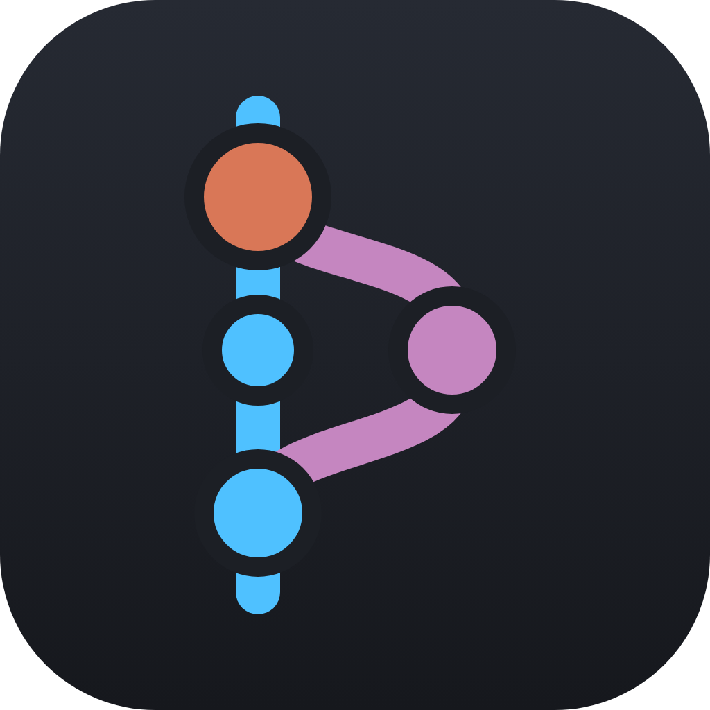
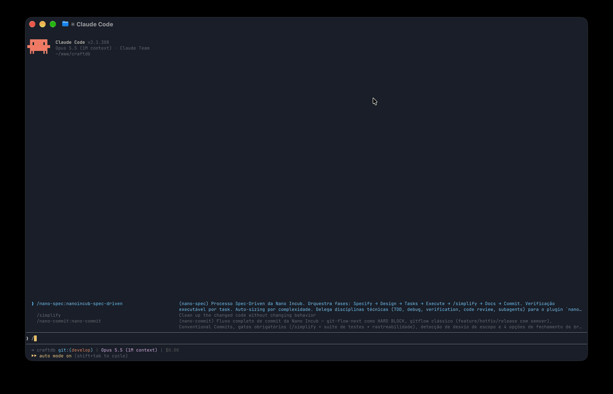
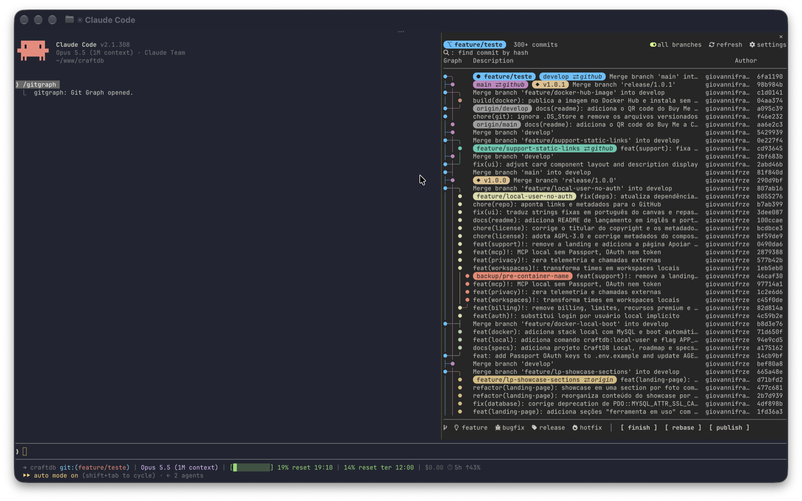
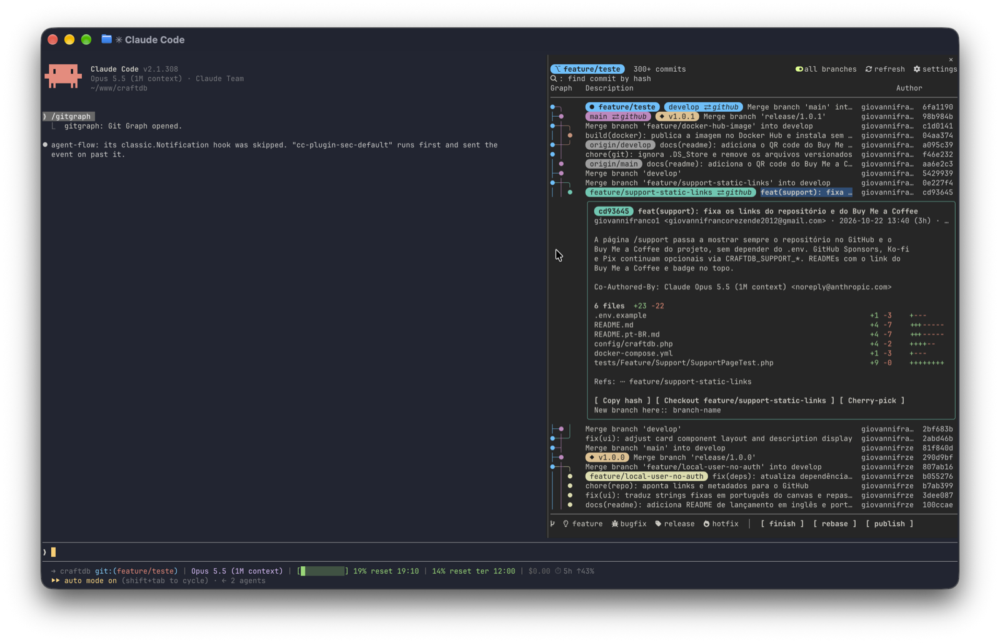
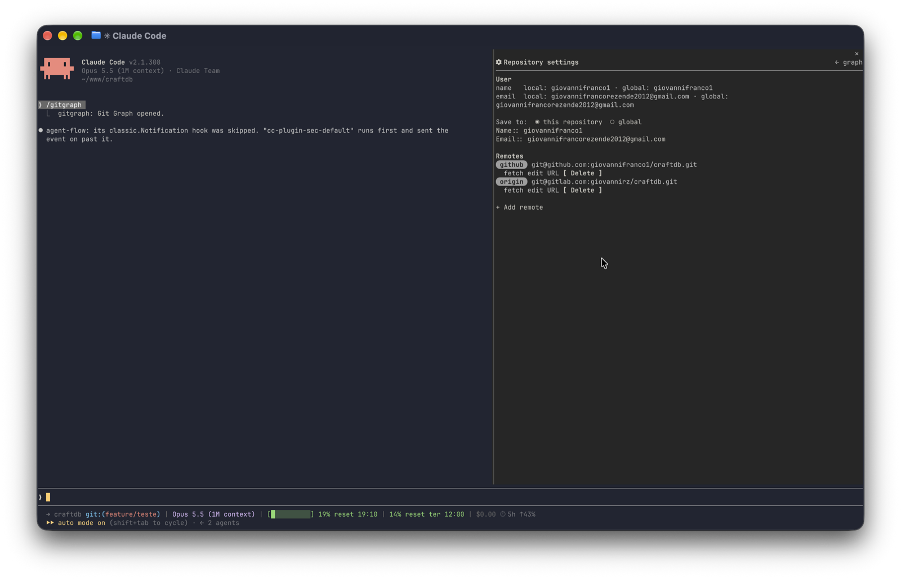

<p align="center">
  
</p>

<h1 align="center">Claude Code Git Graph</h1>

<p align="center">
  Your repository's history beside the chat: a commit graph pane for Claude Code, inspired by the Git Graph extension for VS Code
</p>

<p align="center">
  
  
  
  
</p>

<p align="center">
  
</p>

> [!NOTE]
> gitgraph is a Claude Code **mod** and is built and tested on **Claude Code 2.1.308**. It shows in the right sidebar, which in the terminal needs the fullscreen layout (`/tui fullscreen`) and a terminal at least 110 columns wide; the Desktop app docks it on its own. Rounded badges and the toolbar icons use a [Nerd Font](https://www.nerdfonts.com/) when one is installed, with a plain fallback.

---

## Installation

The repo is its own plugin marketplace. Inside a Claude Code session:

```text
/plugin install gitgraph --marketplace giovannifranco1/claude-code-gitgraph
```

Or from the terminal:

```bash
claude plugin marketplace add giovannifranco1/claude-code-gitgraph
claude plugin install gitgraph@claude-code-gitgraph
```

Then open the pane with:

```text
/gitgraph
```

## Features

- **The commit graph** of the session's repository, one row per commit: a colored lane per line of history, merges (`─╮`), forks (`─╯`) and crossings drawn the way the VS Code extension does, and an `Uncommitted changes` row on top while the working tree is dirty
- **Ref badges** in the color of their lane, drawn in segments: a branch and its remotes in one badge, the remotes on a darker shade of its color (`[develop][origin github]`), with how far the branch is ahead of and behind its upstream (`[feat][origin ↑2 ↓1]`); a remote branch on another commit in that darker shade; the checked-out branch in bold with a hollow dot `○` before its badge; tags in the color of `main`, with a tag icon segment before the version; a dead branch (merged into `main`/`develop`, or deleted here) gray with a ghost. Up to two branch badges per commit, tags apart, the rest counted as `+N`; the first may fill the Description column before its name is cut
- **All branches or just HEAD** with the switch in the header, and **Load more** past 300 commits
- **Several repositories:** when the session folder holds more than one repo (or is no repo but has repos inside, up to three levels down), a `repo:` dropdown at the start of the header picks the one the graph and every action use; each option shows, in a right column, the branch that repo is on (`[develop]`)

  

- **Click a commit's text** to open its details: author, date, full message and every changed file with a diffstat bar. The ⋯ icon on its first row opens its actions: copy its hash, check it out, cherry-pick it or **reset the current branch to it (soft)**; below, create a branch on it. A soft reset moves the branch there and its changes stay staged: the branch moves there and its changes stay staged. As in the VS Code extension, a commit left behind stays in the graph while a ref keeps it (the branch you pushed, `origin/…`), so you can reset back to it
- **Click the Uncommitted changes row** to commit, stash or reset them, in a dialog of their own (in the docked terminal pane). **Commit message** commits every change, new files too (`git add -A`, then `git commit`); **✨ suggest a message** has Claude (haiku) read the diff and the recent commits and write one in their style into the field, to review and edit before you press **commit**. Below, an optional message and **stash** run `git stash push --include-untracked`. **Reset changes…** asks for the mode: **Mixed** (`git reset`) unstages them and keeps the files, **Hard** (`git reset --hard`) discards the changes of tracked files; new files are kept either way

  

- **Click a changed file** in a commit's or a stash's details for its diff, on a screen of its own: hunks, added and removed lines in color, without git's headers (a merge against its first parent; a stash against the commit it was made on). **← graph** or Escape goes back with the commit still open
- **Worktrees:** the worktree icon in the header opens a screen with every worktree (path, branch, changed files); one copies its path or is removed (force when it has changes; the branch stays). **＋ New worktree** on that screen (on a branch typed: an existing one, or a new one off HEAD), **New worktree…** in a local branch's menu, or **New worktree here…** in a commit's actions (on a new branch) opens a dialog that names it after the branch and puts it in `.claude/worktrees/<name>` (or the folder set in Settings, or any **Path**, an empty folder already made included: outside the repository it warns that Claude's session can't reach it). **Create** runs `git worktree add`; **✨ Ask Claude** asks Claude to run it instead. A branch open in another worktree shows the worktree icon in its badge
- **Worktree environments:** with a `worktrees` section in the repository's `gitgraph.json` (what `/nano-worktree init` writes), each worktree in its folder shows its environment status and gets a **↗ host** button per link (opens in the browser), **Up**, **Down**, **Logs** (followed live under it) and **Check**, each only when declared. With `new` and `remove` declared, Create and Remove run the project's script instead of `git worktree`. In the graph, a branch whose worktree environment is up gets a green `●` after its worktree mark.
- **Resolve conflicts with Claude:** with files in conflict, the Uncommitted changes row shows `Conflicts (N)` and its actions start with **✨ Resolve conflicts with Claude** (a git flow conflict has **✨ Ask Claude** beside Continue and Abort). It sends the session's chat a request naming the files and where the conflict came from; Claude resolves and stages them, and leaves committing and continuing to you
- **Compare two points:** **Compare with HEAD** or **Mark for compare** in a commit's actions (its row then ends its description with a blue git compare icon, `①` without a Nerd Font, and **Compare with abc1234** shows in another's; **Unmark for compare** takes it off), or **Compare with current branch** in a branch's menu. The comparison says how far apart they are (`feat: 3 ahead, 1 behind main`) and lists the files that differ; click one for its diff between the two
- **Stashes in the graph:** each stash is a row with a `◇` off the commit it was made on, its name (`stash@{0}`) in a badge. Click it for its files (new ones too) and **Apply stash**, **Pop stash** or **Drop stash…** (pressed twice)
- **Click a badge** for its ref's menu, a list in groups (a right click works too; where clicks do not reach the pane, open a commit and use its **Branch actions** buttons):
  - **Local branch:** checkout, push branch, merge into the current branch, rebase the current branch on it, rename, copy name, delete branch (with an optional `force` and, when a remote has it, **also on origin** to delete it there too, both off by default)
  - **Remote branch:** checkout as a new tracking branch, fetch, merge, copy name, delete on the remote
  - **Tag:** push, copy name, delete
  - **Double-click** a badge to check it out
- **Dialogs:** in the docked terminal pane, menus, a commit's actions, push, delete, rename and every Git Flow action open in a dialog floating over the graph; the dialog's button runs at once, `cancel` or `close` runs nothing

- **Push to the remotes you pick:** Push branch opens a choice of remotes, starting with the ones the branch tracks, plus `all`. A push to several remotes runs one push each and reports every failure by its remote
- **Safe actions:** destructive ones ask for a second press (or run from their dialog's button); a spinner shows what git is doing and further presses wait for it; push and fetch never hang on a password prompt
- **Find a commit by hash, message or author** from the search icon: the pane selects it and scrolls to it. With several matches the field keeps the term and says `Match 2/5`; find again for the next one, in a loop
- **Git Flow** with [git-flow-next](https://github.com/gittower/git-flow-next), from the footer: `Git Flow · feature/login · from develop · ↑2 ↓1 origin` says where the branch came from and how it stands with its upstream (or `not published`), and opens the Git Flow dialog, a row per type:
  - **Start** a feature, bugfix, release or hotfix from the base your git flow config gives it; a release or hotfix name comes filled in with the next version after your highest tag
  - On a work branch: **finish** (switches for `no-ff`, push afterwards and keep branch, all on by default; release and hotfix tags get an editable message, the version by default) and **rebase** (or merge, as your config says). To publish a branch, use **Push branch**
  - Release and hotfix finish as classic git flow: into `main` with the tag, then the branch itself is merged into `develop` (a hotfix into an open `release/*` instead), not `main` into `develop` as git-flow-next does
  - A finish or update that stops on a conflict offers **Continue** and **Abort**
  - A work branch's badge menu has the same actions; repositories without git flow get **Set up git flow…**, a form for your own names (`master`, `dev`, `feat/`, `fix/`…, prefilled from the branches the repo already has, plus an optional tag prefix), and **Use defaults** for the standard ones (`main`, `develop`, `feature/`, `bugfix/`, `release/`, `hotfix/`)
- **Settings:** the list's **columns** (hide the author or the hash to give the graph and the description more room; for every repository, kept between sessions), user name and email for this repository or globally, the remotes (add, edit the URL, fetch, delete) and, where git flow is set up, its names with **Reconfigure…** to change them

  

- **Always current:** after every Bash call Claude makes and every 5 seconds while the pane is open, gitgraph compares the repository's refs and status and reloads only when something changed. The header's icon buttons: **search** (magnifier) opens the search; **settings** (gear) opens the repository settings; **changelog** (☰) shows what changed in each version, yours marked; **fetch** (cloud) runs `git fetch --all` (in a dialog while it runs, in the docked terminal pane) and redraws the graph with what the remotes brought; **refresh** reloads everything on screen and flashes `✓`
- **Light on big histories:** only the rows on screen are drawn, so scrolling stays smooth with hundreds of commits; in the docked terminal pane gitgraph scrolls its own rows, so the header and footer hold still. The graph column is as wide as the rows on screen need

## Settings

Settings are in `/config` under gitgraph.

- **Badges:** `auto` (default) draws rounded badges when a Nerd Font is installed, `round` always does, `square` draws square badges. Pick `square` if your terminal's font has no Nerd Font glyphs.

## How it works

gitgraph runs the git already on your machine, in the session's working directory: `git log`, `git status --porcelain=v2` and `git for-each-ref` to draw the graph, `git show --numstat` for a commit's details, and `git flow` (git-flow-next) for Git Flow, which reads the repository's `gitflow.*` config and `git tag --list`. Every git command is passed as a list of arguments, never through a shell, and names you type (branches, remotes, URLs) are validated before git sees them.

Besides git, gitgraph runs one command at session start and when the pane opens: `sh -c 'ls <font folders> | grep -qi nerd'`, to tell whether a Nerd Font is installed for the rounded badges and icons; and, when the pane opens and on refresh, a `find` for `.git` folders up to four levels below the session folder (skipping `node_modules`, `vendor`, build output and hidden folders). Neither reads file contents or sends anything anywhere. The only network traffic is git's own, when you press push, fetch or a Git Flow finish: it goes to the remotes you configured, with `GIT_TERMINAL_PROMPT=0` so it never asks for a password; git never opens an editor either (`GIT_EDITOR=true`). After a Git Flow finish with push on, it pushes the branches the finish merged into, with their tags, to your git flow remote (`gitflow.origin`, else `origin`, else the repository's first remote). Claude Code runs a mod's git with the repository's hooks off; for `git flow` gitgraph points the hooks at an empty folder it ships (`nohooks/`), so they stay off and git-flow-next, which fails on Claude Code's `/dev/null` hooks path, finds none. gitgraph keeps its view state in the Claude Code session only, and its column choice in its own Claude Code store.

## Contributing

```bash
claude plugin validate .
claude plugin test .
tsc -p .
```

The graph layout, git output parsing, badges, menus and settings logic are plain functions in `hooks/` with tests in `tests/`; `hooks/register.tsx` wires them to Claude Code. The specs it was built from are in `.specs/`.

## License

[MIT](LICENSE)
