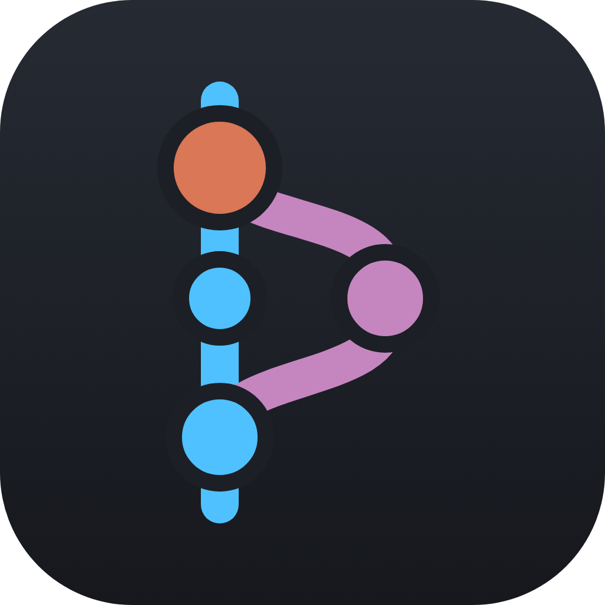
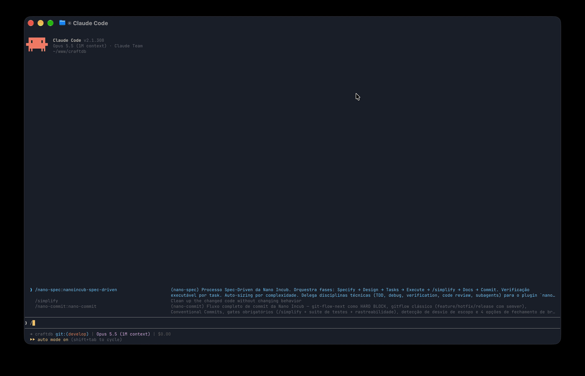
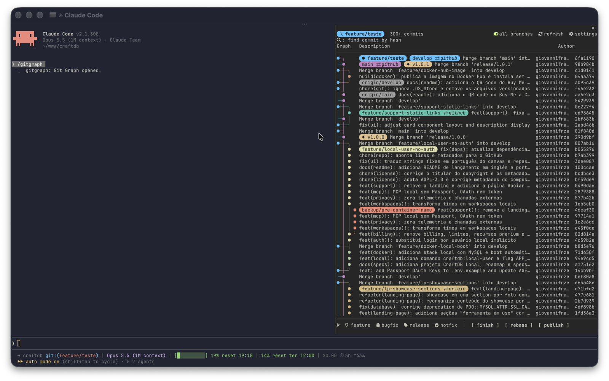
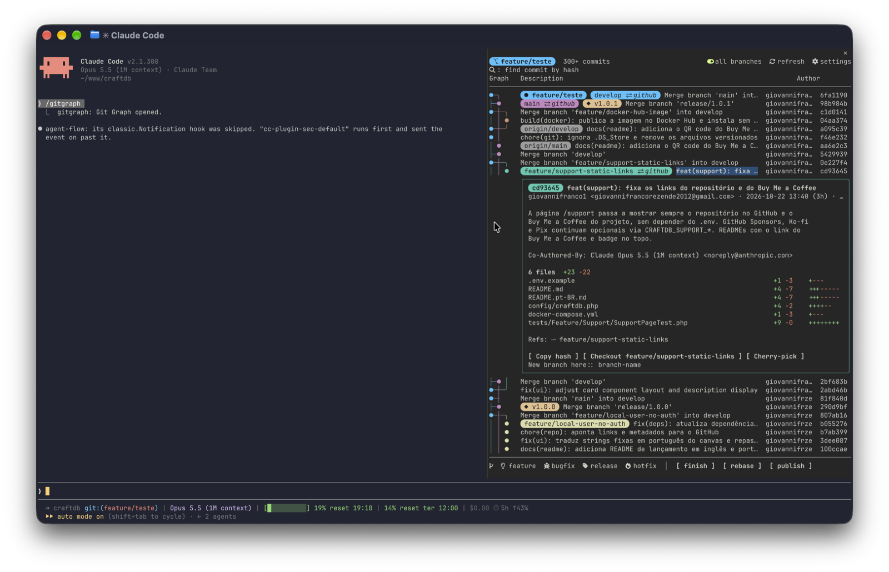
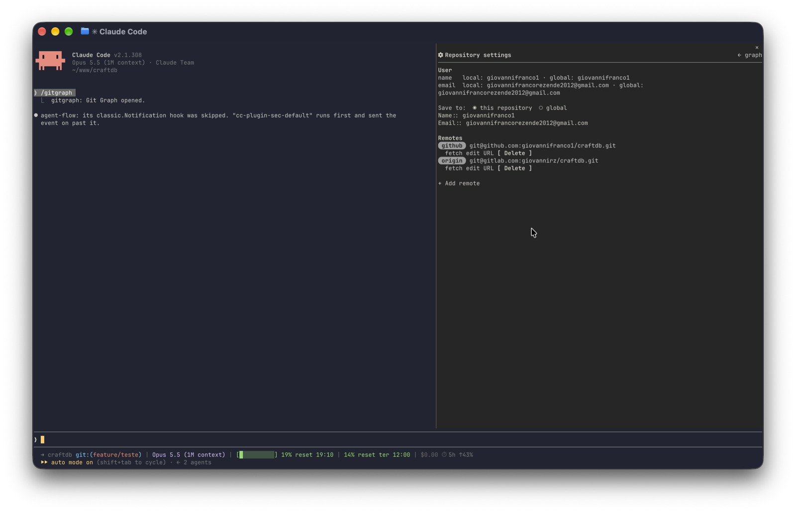

<p align="center">
  
</p>

<h1 align="center">Claude Code Git Graph</h1>

<p align="center">
  Your repository's history beside the chat: a commit graph pane for Claude Code, inspired by the Git Graph extension for VS Code
</p>

<p align="center">
  
  
  
  
</p>

<p align="center">
  
</p>

> [!NOTE]
> gitgraph is a Claude Code **mod** and is built and tested on **Claude Code 2.1.308**. It shows in the right sidebar, which in the terminal needs the fullscreen layout (`/tui fullscreen`) and a terminal at least 110 columns wide; the Desktop app docks it on its own. Rounded pills and the toolbar icons use a [Nerd Font](https://www.nerdfonts.com/) when one is installed, with a plain fallback.

---

## Installation

The repo is its own plugin marketplace. Inside a Claude Code session:

```text
/plugin install gitgraph --marketplace giovannifranco1/claude-code-gitgraph
```

Or from the terminal:

```bash
claude plugin marketplace add giovannifranco1/claude-code-gitgraph
claude plugin install gitgraph@claude-code-gitgraph
```

Then open the pane with:

```text
/gitgraph
```

## Features

- **The commit graph** of the session's repository, one row per commit: a colored lane per line of history, merges (`─╮`), forks (`─╯`) and crossings drawn the way the VS Code extension does, and an `Uncommitted changes` row on top while the working tree is dirty
- **Ref pills** in the color of their lane: the checked-out branch in bold with `●`, a local branch and its remotes in one pill (`develop ⇄ origin github`), remote-only branches in gray, tags in gold (`◆ v1.0.1`). Pills that don't fit are shortened, then counted as `+N`
- **All branches or just HEAD** with the switch in the header, and **Load more** past 300 commits
- **Several repositories:** when the session folder holds more than one repo (or is no repo but has repos inside, up to three levels down), a `repo:` dropdown at the start of the header picks the one the graph and every action use

  

- **Click a commit** to open its details: author, date, full message and every changed file with a diffstat bar. From there, copy its hash, check it out, cherry-pick it or create a branch on it

  

- **Right-click a branch pill** for its menu, as in the VS Code extension:
  - **Local branch:** checkout, rename, push branch, merge into the current branch, rebase the current branch on it, delete branch (with an optional `force`, off by default), copy name
  - **Remote branch:** checkout as a new tracking branch, fetch, merge, delete on the remote, copy name
  - **Tag:** push, delete, copy name
  - **Double-click** a pill to check it out

- **Push to the remotes you pick:** Push branch opens a choice of remotes, starting with the ones the branch tracks, plus `all`. A push to several remotes runs one push each and reports every failure by its remote
- **Safe actions:** destructive ones ask for a second press; a spinner shows what git is doing and further presses wait for it; push and fetch never hang on a password prompt
- **Find a commit by hash** from the search icon, 4 to 40 hex digits: the pane selects it and scrolls to it
- **Git Flow actions** in a bar at the bottom of the pane (`⎇  feature  bugfix  release  hotfix │ finish  rebase  publish`), with [git-flow-next](https://github.com/gittower/git-flow-next):
  - **Start** a feature, bugfix, release or hotfix from the base your git flow config gives it; a release or hotfix name comes filled in with the next version after your highest tag
  - On a work branch: **finish** (switches for `no-ff`, push afterwards and keep branch, all on by default; release and hotfix tags get an editable message), **rebase** (or merge, as your config says) and **publish**. Publish and finish ask for a second press
  - A finish or update that stops on a conflict offers **Continue** and **Abort**
  - Right-click any work branch's pill for the same actions; repositories without git flow get a **Start git flow** button that sets it up with the standard names (`main`, `develop`, `feature/`, `bugfix/`, `release/`, `hotfix/`)
- **Repository settings:** user name and email for this repository or globally, and the remotes: add, edit the URL, fetch, delete

  

- **Always current:** after every Bash call Claude makes and every 5 seconds while the pane is open, gitgraph compares the repository's refs and status and reloads only when something changed. The header's icon buttons: **search** (magnifier) opens the hash search; **settings** (gear) opens the repository settings; **fetch** (cloud) runs `git fetch --all` and redraws the graph with what the remotes brought; **refresh** reloads everything on screen and flashes `✓`
- **Light on big histories:** only the rows on screen are drawn, so scrolling stays smooth with hundreds of commits

## Settings

Settings are in `/config` under gitgraph.

- **Badges:** `auto` (default) draws rounded pills when a Nerd Font is installed, `round` always does, `square` draws square pills. Pick `square` if your terminal's font has no Nerd Font glyphs.

## How it works

gitgraph runs the git already on your machine, in the session's working directory: `git log`, `git status --porcelain=v2` and `git for-each-ref` to draw the graph, `git show --numstat` for a commit's details, and `git flow` (git-flow-next) for the Git Flow bar, which reads the repository's `gitflow.*` config and `git tag --list`. Every git command is passed as a list of arguments, never through a shell, and names you type (branches, remotes, URLs) are validated before git sees them.

Besides git, gitgraph runs one command at session start: `sh -c 'ls <font folders> | grep -qi nerd'`, to tell whether a Nerd Font is installed for the rounded pills and icons; and, when the pane opens and on refresh, a `find` for `.git` folders up to four levels below the session folder (skipping `node_modules`, `vendor`, build output and hidden folders). Neither reads file contents or sends anything anywhere. The only network traffic is git's own, when you press push, fetch, publish or a Git Flow finish: it goes to the remotes you configured, with `GIT_TERMINAL_PROMPT=0` so it never asks for a password; git never opens an editor either (`GIT_EDITOR=true`). After a Git Flow finish with push on, it pushes the branches the finish merged into, with their tags, to your git flow remote (`origin` by default). Claude Code runs a mod's git with the repository's hooks off; for `git flow` gitgraph points the hooks at an empty folder it ships (`nohooks/`), so they stay off and git-flow-next, which fails on Claude Code's `/dev/null` hooks path, finds none. gitgraph keeps its view state in the Claude Code session only.

## Contributing

```bash
claude plugin validate .
claude plugin test .
tsc -p .
```

The graph layout, git output parsing, pills, menus and settings logic are plain functions in `hooks/` with tests in `tests/`; `hooks/register.tsx` wires them to Claude Code. The specs it was built from are in `.specs/`.

## License

[MIT](LICENSE)
